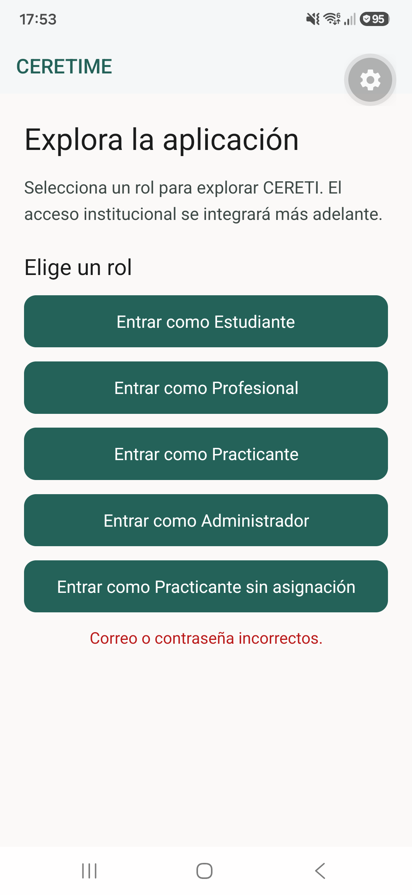
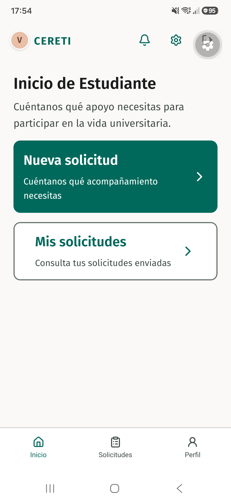

# Evidencia TI4-52

## Comprobación Android

- Dispositivo: Samsung Galaxy S23 (`SM-S911B`), Android 16, API 36; TalkBack 16.2.00.12 con voz en español y escala de texto del sistema en 100 %.
- Cliente de desarrollo `cl.rmv.ceretime.qa`, versión 1.0.0; binario nativo compilado desde `641c967173f5acc02032a51ec0e35ce48431891a` y SHA-256 `b2dbe2bb281224ab59970294867306be416795a05fa43409c80af5f593eb09da`.
- El cliente cargó el código JavaScript de esta rama mediante Metro por USB; la aplicación institucional instalada con el identificador `cl.rmv.ceretime` no se reemplazó.
- Con TalkBack activo, seleccioné Estudiante en el acceso simulado y llegué a Inicio; las opciones de rol permanecieron operables con doble toque.
- Para probar el rechazo, forcé una única vez al adaptador simulado a rechazar la primera llamada de autenticación durante la ejecución local; apareció «Correo o contraseña incorrectos.» y el mismo botón permitió reintentar hasta abrir Inicio de Estudiante.
- La inyección de fallo se retiró antes del commit; el código publicado conserva únicamente el adaptador y las credenciales ficticias existentes.
- No se grabó el audio de TalkBack; las pruebas automatizadas verifican un único anuncio de carga, el mensaje accesible de error y el evento de foco antes del reintento.

## Restauración

Al terminar detuve Metro, desinstalé el cliente `.qa` y restauré los ajustes originales de TalkBack, exploración táctil y escala del sistema; el paquete institucional permaneció instalado.

## Capturas de Android

### Error de acceso

### Reintento exitoso

