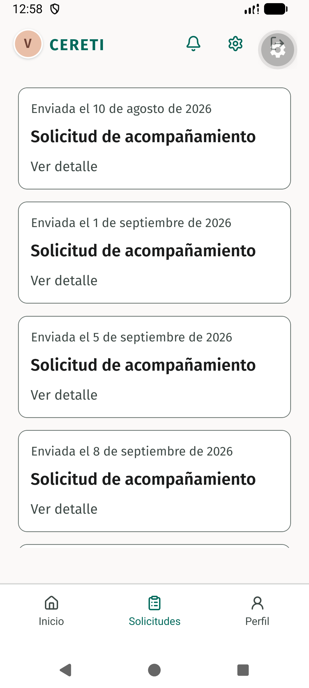
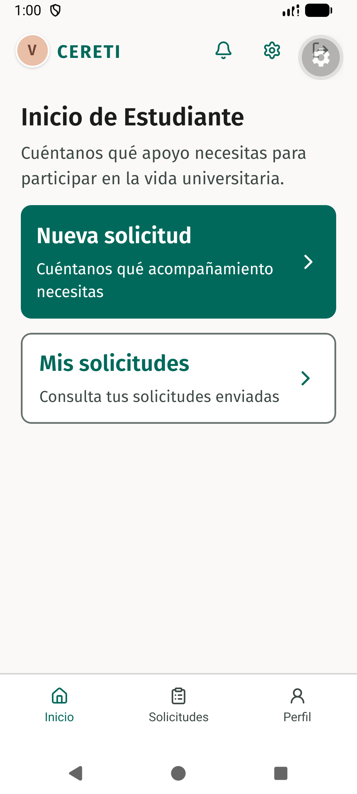
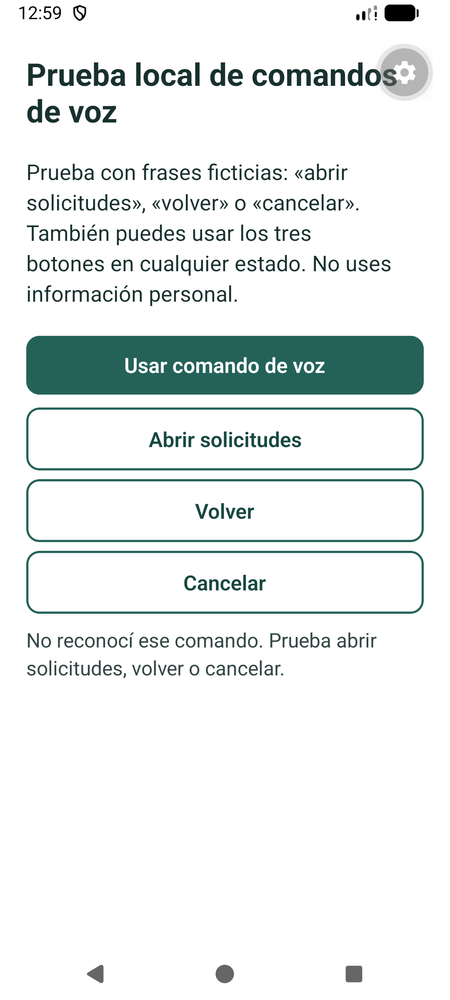
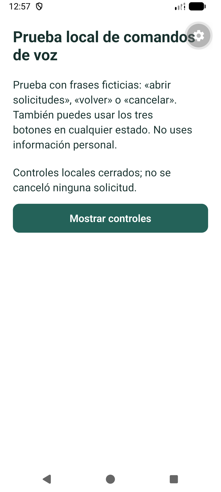
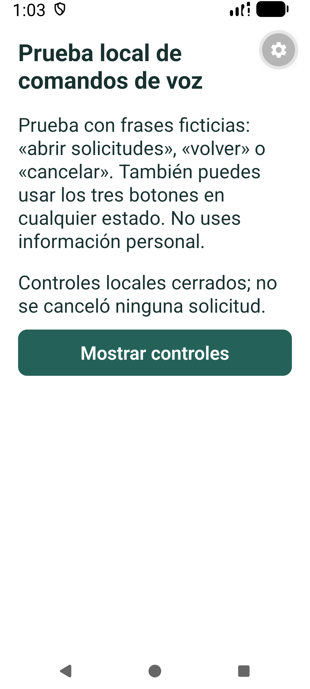
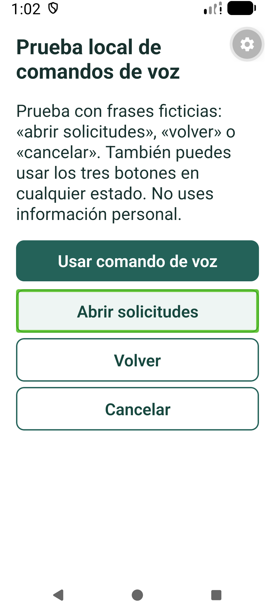

# Registro de evidencia nativa TI4-61

## Entorno ejecutado

Dispositivo: emulador `Medium_Phone`, imagen `sdk_gphone16k_x86_64`, Android 17/API 37; paquete `cl.rmv.ceretime`; Expo SDK 57, React Native 0.86.3 y `expo-speech-recognition` 57.1.1 con el parche del repositorio.

La fuente JavaScript ejecutada fue `f3b95c6f4e69b1a4832d2bebde3460f465b17596`, que incluye la base TI4-56 `efb46e8`, el límite de sesión de 12 segundos `7581f8a` y el ajuste para comandos breves `500a341`.

El build nativo `assembleDebug` terminó en 2 min 59 s; se instaló el APK de 90 MB en el emulador. Metro se conectó por el puerto 8081 con ADB reverse. Tras un bloqueo de la vista se ejecutó con `ANDROID_EMULATOR_FEATURES=-Vulkan`.

El servicio reportó inicialmente el modelo local `en-US`; las capacidades `supportsOnDeviceRecognition` y `isRecognitionAvailable` estaban activas. Se solicitó el modelo español con `ExpoSpeechRecognitionModule.androidTriggerOfflineModelDownload({ locale: "es-ES" })`; Android informó 49.31 MB y `download_success`, y la lista instalada pasó a `en-US, es-ES`.

Después de instalar el modelo, la prueba se repitió con WiFi y datos móviles apagados. La locución sintética en español se generó al vuelo con velocidad 120 y amplitud 180, se convirtió a PCM con `ffmpeg` y se inyectó al micrófono del emulador mediante un monitor de audio de PipeWire. No se guardaron el audio ni la transcripción.

## Resultados observados

| Prueba                                | Resultado observado                                                                                                                                                                                                                                      | Evidencia                                                                                                              |
| ------------------------------------- | -------------------------------------------------------------------------------------------------------------------------------------------------------------------------------------------------------------------------------------------------------- | ---------------------------------------------------------------------------------------------------------------------- |
| Comando de voz «abrir solicitudes»    | Abrió la ruta canónica `/estudiante/solicitudes` y mostró la lista real del flujo con fixtures; no envió ni creó solicitudes.                                                                                                                            |                                   |
| Comando de voz «regresar»             | El alias reconocido ejecutó `router.back()` y volvió a Inicio de Estudiante.                                                                                                                                                                             |                                        |
| Frase sintética «volver»              | El reconocedor devolvió una frase desconocida; el mensaje permaneció visible y no navegó. Esto no demuestra que personas no puedan pronunciarla, solo que esta síntesis no se reconoció en esta ejecución.                                               |                              |
| Comando de voz «cancelar»             | Cerró los controles temporales y mostró que no se canceló ninguna solicitud.                                                                                                                                                                             |                          |
| Cancelación táctil durante la escucha | Tras tocar cancelar, se envió la frase sintética «abrir solicitudes»; los controles siguieron cerrados y no hubo navegación tardía.                                                                                                                      |                       |
| Permiso de micrófono denegado         | Se mostró el estado de permiso denegado y quedaron disponibles Abrir solicitudes, Volver y Cancelar.                                                                                                                                                     |                                 |
| TalkBack, foco y texto ampliado       | TalkBack estaba enlazado y `touchExplorationEnabled=true`; con `font_scale=1.6`, dos pulsaciones Tab dejaron foco verde en Abrir solicitudes y los tres botones permanecieron completos y visibles. Un `adb tap` activó Cancelar con TalkBack encendido. |  |
| Silencio con límite de escucha        | El timeout compartido de 12 s cerró la sesión sin acción de navegación; este caso se comprobó con el probe de TI4-56.                                                                                                                                    | [Evidencia y alcance del probe TI4-56](../ti4-56/README.md)                                                            |

No se probaron gestos manuales de TalkBack ni el doble toque de activación; la comprobación de navegación usó ADB/teclado y la captura registra el foco visual observado.

## Reproducir el entorno

Después de integrar los cambios y retirar las rutas temporales, una nueva ejecución requiere agregar temporalmente las rutas de diagnóstico desde sus wrappers documentados en [TI4-56](../ti4-56/README.md) y el componente de probe de esta ruta. Para TI4-61, copiar `apps/mobile/docs/evidence/ti4-61/native-probe.tsx` directamente a `apps/mobile/app/ti4-61-probe.tsx`; retirar ambos archivos de `apps/mobile/app/` después de la prueba.

En el checkout con dependencias instaladas, el build x86_64 se ejecutó desde `apps/mobile/android` con:

```sh
ANDROID_HOME=/home/corvo/Android/Sdk JAVA_HOME=/usr/lib/jvm/java-21-openjdk ./gradlew :app:assembleDebug -PreactNativeArchitectures=x86_64 --console=plain
```

Se instaló la compilación con `adb install -r app/build/outputs/apk/debug/app-debug.apk`; para el cliente de desarrollo, se conectó el puerto del host con `adb reverse tcp:8081 tcp:8081` y se abrió la ruta temporal con:

```sh
adb shell am start -a android.intent.action.VIEW -d ceretime://ti4-61-probe
```

Para descargar el modelo on-device español, se añadió temporalmente al diagnóstico una llamada a `ExpoSpeechRecognitionModule.androidTriggerOfflineModelDownload({ locale: "es-ES" })`; confirmar el evento `download_success` y que `es-ES` figure entre los idiomas instalados antes de desconectar WiFi y datos móviles.

La app de desarrollo puede volver a abrir el flujo con Metro en el puerto 8081 y la conexión ADB reverse ya establecida; el emulador usado se inició con `ANDROID_EMULATOR_FEATURES=-Vulkan` para evitar repetir el bloqueo visual observado.

Metro y emulador se iniciaron para esta ejecución con autorización del usuario. Esta nota describe la topología observada; no afirma que las pruebas puedan repetirse en un dispositivo sin el modelo descargado y sin la compilación nativa del proveedor.

## Límites de la conclusión

Esta es una prueba de integración del emulador Android 17/API 37 con audio sintético y modelo `es-ES`; no es una medición de precisión del reconocimiento humano. En particular, «volver» fue `unknown` y «regresar» fue el alias que sí activó el retorno en esta ejecución.

No se ejecutó en un teléfono físico, iOS, versiones Android distintas, idiomas distintos ni con varias voces humanas. No se midieron falsos positivos poblacionales, ruido ambiental, acentos, seguridad acústica ni cumplimiento WCAG general.
