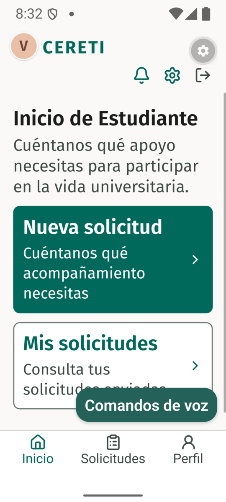
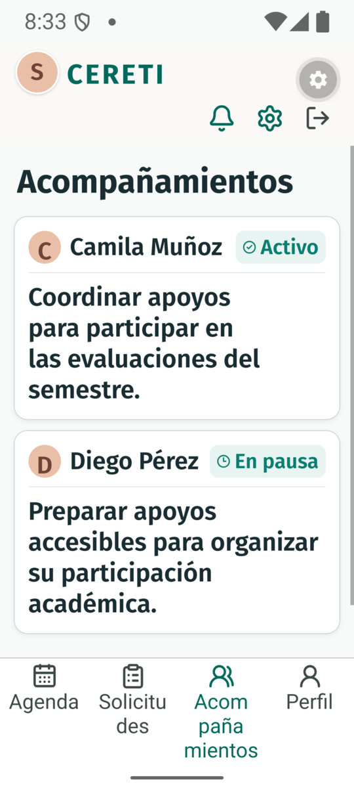
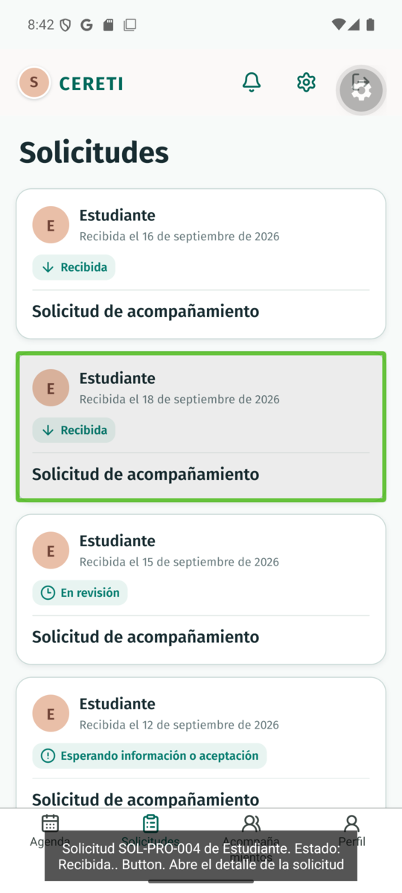
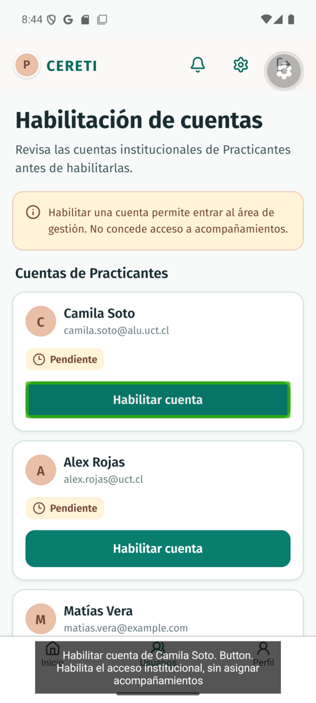
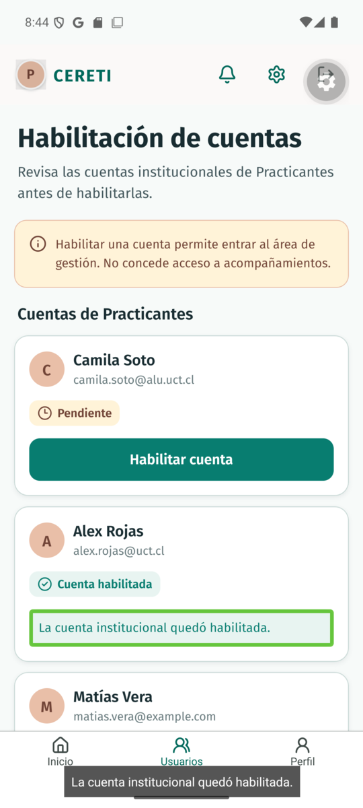
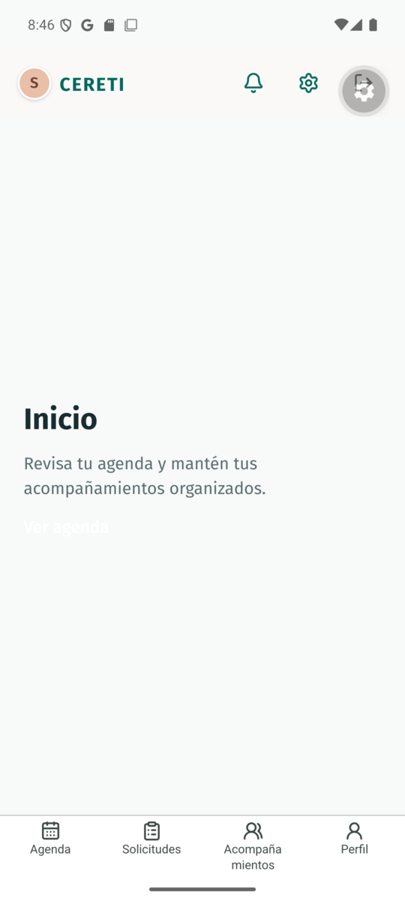

# TI4-64: comprobaciones propias de la consolidación WCAG

<!-- cspell:words talkback keyevent -->

Issue: [TI4-64](https://linear.app/ceretime/issue/TI4-64). Consolidación del 3 de noviembre de 2026 sobre `main` `5c641432cb5179469cdd303147dcb68375f0c89a` (B1), en la rama `vrivera/ti4-64-consolidar-evidencias-talkback`. El resultado vive en la [matriz WCAG](../../accessibility/wcag-matrix.md), sección Consolidación S4; este informe registra lo que se comprobó para escribirla y lo que no.

## Comprobaciones de repositorio

Con datos ficticios y sin tocar código de la aplicación:

| Comprobación                                                                                           | Resultado                                                                                                                                                                                                                                                                                                                                                    |
| ------------------------------------------------------------------------------------------------------ | ------------------------------------------------------------------------------------------------------------------------------------------------------------------------------------------------------------------------------------------------------------------------------------------------------------------------------------------------------------ |
| Jest de Mobile en B1: `build-run bun run --cwd apps/mobile test`, tras `bun install --frozen-lockfile` | 26 suites y 273 pruebas pasan, las mismas cifras que registra [TI4-63](../ti4-63/README.md). Sin la instalación, 13 suites fallaban por el módulo `expo-speech` ausente en `node_modules`; era un entorno local desactualizado, no un defecto.                                                                                                               |
| Vigencia de E63: `git diff bfd60b4 HEAD -- apps/mobile/src apps/mobile/app`                            | Vacío. `bfd60b4` no es ancestro de `main` (squash), de modo que se comparó el árbol.                                                                                                                                                                                                                                                                         |
| Vigencia del cierre táctil de E63: la misma diferencia desde `6656b03`                                 | Solo `role-tabs.tsx` y el `_layout.tsx` del Profesional, es decir, las pestañas compactas de la última sección de E63.                                                                                                                                                                                                                                       |
| Vigencia de E52, E57 y E58: la misma diferencia desde `641c967`, binario de esas pruebas               | Cambiaron cabecera, pestañas, formulario y flujo del Estudiante, la lista del Administrador (tamaño del avatar), el `_layout.tsx` del Profesional y el módulo de voz. Las pantallas del Profesional y del Practicante no cambiaron. El JavaScript probado era el de la rama de la PR, sin commit consignado: la comparación acota la vigencia, no la prueba. |
| Rutas de B1 frente al inventario: `find apps/mobile/app -name '*.tsx'`                                 | La única ruta nueva desde B0 es `/preferencias`, con su bloque de filas. No existe ruta de reserva estudiantil.                                                                                                                                                                                                                                              |

## Pasada nativa en Android

Vicente pidió ejecutar en el emulador que tenía abierto, lo que cumple la autorización explícita que exige [AGENTS.md de Mobile](../../../AGENTS.md) para iniciar Metro.

- Dispositivo: emulador `Pixel_8_API_35` (Android 15), TalkBack 15.0.
- Código: JavaScript de B1 servido por Metro en el puerto 8081 con `adb reverse`. El cliente de desarrollo instalado era del 10 de octubre y no incluía el módulo nativo `ExpoSpeech`, de modo que se volvió a compilar con `build-run bunx expo run:android`; ese APK reemplaza al anterior en el emulador.
- Sesión: modo simulado con datos ficticios y el modo `fail-once` del Metro de la sesión. La preferencia de la app se dejó en «Seguir el sistema».

### Texto ampliado (M4)

Escala del sistema 1.0, 1.5 y 2.0 con `settings put system font_scale`. Para cada rol se reinició la app y se capturaron sus primeras pantallas: Estudiante (inicio, dos pasos de Nueva solicitud, Mis solicitudes, detalle, perfil y preferencias), Profesional (agenda, detalle de la actividad, solicitudes, detalle de solicitud, acompañamientos, su detalle y perfil), Practicante (asignaciones, detalle y perfil) y Administrador (inicio, usuarios y perfil).

Resultado: el texto crece, sigue legible y las pantallas se desplazan. Lo que cambia o molesta:

- Desde el 150 % las acciones de la cabecera (avisos, preferencias, cerrar sesión) bajan a una segunda fila en los cuatro roles. No se pierden.
- En el Estudiante, el botón flotante «Comandos de voz» tapa parte del contenido al 150 % y al 200 %.
- En el Profesional, las pestañas parten las etiquetas largas: «Acompañamientos» en dos líneas al 150 % y, al 200 %, también «Solicitudes», en ambos casos por mitad de palabra.
- En la agenda del Profesional el pie «Hoy» cubre parcialmente la última tarjeta al 150 % y al 200 %; la lista se desplaza.

Ninguno de estos puntos se marcó como fallo: el contenido sigue accesible. Quedan como observación para quien decida el diseño.

### TalkBack (M1 y M3 parcial)

Se activó TalkBack, con «Display speech output» en los ajustes de desarrollador de TalkBack para que el texto que dice quede en pantalla. Los deslizamientos de `adb input` no mueven el foco de TalkBack y un toque de `adb` activa el control, de modo que el foco se movió con `adb shell input keyboard keyevent KEYCODE_TAB` y se activó con `KEYCODE_ENTER`. `uiautomator` se evitó con TalkBack encendido porque suspende los servicios de accesibilidad.

- Profesional, cabecera: el avatar se lee «Perfil de Sam Profesional», seguido de «Preferencias de accesibilidad. Button. Abre los ajustes compartidos de texto, contraste y movimiento» y «Cerrar sesión. Button. Cierra tu sesión actual». El aviso queda fuera del orden de Tab porque está inhabilitado (`disabled`) a propósito.
- Profesional, solicitudes: cada tarjeta se lee «Solicitud SOL-PRO-001 de Estudiante. Estado: Recibida. Button. Abre el detalle de la solicitud», con el estado de cada una.
- Profesional, acompañamientos: «Acompañamiento de Camila Muñoz. Estado: Activo. Coordinar apoyos… Button. Abre el detalle del acompañamiento».
- Administrador, usuarios: el estado se lee «Estado: Pendiente» y el botón «Habilitar cuenta de Camila Soto. Button. Habilita el acceso institucional, sin asignar acompañamientos». Al activarlo con Enter, el foco queda en «La cuenta institucional quedó habilitada.» y ese texto es el que muestra el subtítulo.

El subtítulo es la salida de voz que TalkBack declara, no una audición: nadie oyó el audio, así que H5 y H6 de TI4-48 siguen sin confirmación auditiva. El teclado fue simulado con `adb`, no un teclado físico.

### Defecto nuevo en `/profesional/inicio`

Al volver desde el detalle de una solicitud la app mostró `/profesional/inicio`, ruta sin pestaña (`href: null`). El botón «Ver agenda» aparece con texto blanco y sin su fondo `#087D70`, que sí figura en `professional-home-screen.tsx`. Se reprodujo tras reiniciar la app, con TalkBack apagado y encendido. La causa no se determinó y no se tocó código: la fila 1.4.3 de esa ruta queda Fallido (E64) y la corrección necesita su propia tarea.

## Qué queda abierto

Todo criterio sin una ejecución suficiente sigue como No probado, con su motivo en la fila. No se comprobó en dispositivo: horizontal y reflujo, espaciado, contraste medido, objetivos táctiles medidos, teclado físico, desplazamiento completo y estados de error con texto ampliado, TalkBack combinado con 200 % en el flujo guiado, 150 % del flujo guiado, el Practicante y el Estudiante con TalkBack, y la audición de los anuncios H5 y H6. La prueba final de Juan y los comandos de Fernando de S4 tienen evidencia propia y no se esperaron.

Para cerrar esos criterios, una sesión con dispositivo debe seguir los métodos M1 a M10 de la matriz y añadir una versión por cada repetición, sin reescribir las filas anteriores.
